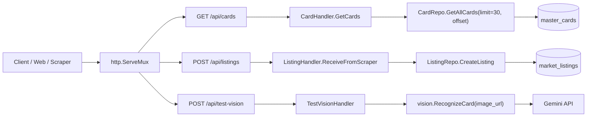

# API Endpoints

Source of truth: `internal/routes/routes.go`.



## Endpoint Map

| Method | Path | Handler | Input | Success response | Storage/service |
| --- | --- | --- | --- | --- | --- |
| `GET` | `/api/cards?page=1` | `CardHandler.GetCards` | Query `page`, optional positive integer. Defaults to `1`. | `200` JSON array of cards. Empty result is `[]`. | Reads `master_cards`. |
| `POST` | `/api/listings` | `ListingHandler.ReceiveFromScraper` | JSON listing payload from scraper. `daangn_id` is required. | `201` when inserted, `200` when duplicate already existed. | Inserts/updates `market_listings`. |
| `POST` | `/api/test-vision` | `TestVisionHandler` | JSON with `image_url`. | `200` JSON vision result. | Calls `vision.RecognizeCard`. |

## GET /api/cards

Returns cards from `master_cards`, ordered by `id`.

Query params:

| Name | Type | Required | Default | Notes |
| --- | --- | --- | --- | --- |
| `page` | integer | No | `1` | Values `<= 0` or invalid values fall back to `1`. Page size is fixed at `30`. |

Response item:

```json
{
  "id": "string",
  "name": "string",
  "image_url": "string",
  "card_no": "string",
  "rarity": "string",
  "series": "string"
}
```

Errors:

| Status | Cause |
| --- | --- |
| `500` | Database query failed. |

## POST /api/listings

Receives listings from the scraper and stores them in `market_listings`.

Request:

```json
{
  "daangn_id": "string",
  "title": "string",
  "price": 0,
  "image_url": "string",
  "source_url": "string",
  "created_at": "2026-06-24 12:00:00",
  "boosted_at": "2026-06-24 12:00:00"
}
```

Behavior:

- Inserts a new row with `status = "pending"`.
- Uses `external_id = daangn_id`.
- If `external_id` already exists, does not insert a duplicate.
- For duplicates, fills missing `image_url`, `created_at`, and `boosted_at` when possible.

Success responses:

```json
{
  "status": "saved",
  "message": "new listing saved"
}
```

```json
{
  "status": "ignored",
  "message": "listing already exists"
}
```

Errors:

| Status | Cause |
| --- | --- |
| `400` | Invalid JSON. |
| `400` | Missing `daangn_id`. |
| `500` | Database insert/update failed. |

## POST /api/test-vision

Temporary endpoint for testing card recognition by image URL.

Request:

```json
{
  "image_url": "https://example.com/card.jpg"
}
```

Response:

```json
{
  "name": "string",
  "rarity": "string",
  "card_no": "string",
  "is_pokemon_card": true
}
```

Errors:

| Status | Cause |
| --- | --- |
| `400` | Invalid JSON or missing expected request shape. |
| `500` | Vision recognition failed. |

